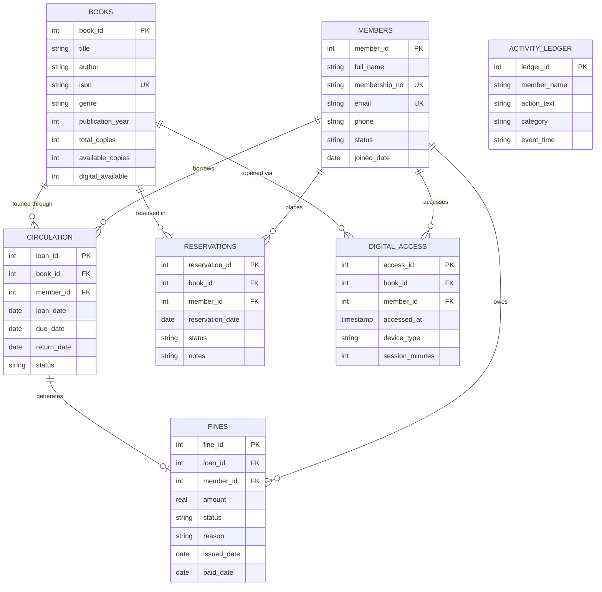

# The Reading Room — Library Operations System & SQL Database

A full-stack, editorial library operations web application backed by an SQLite relational database (`library.db`), faithfully replicating the design and workflow of **"The Reading Room / LIBRARY OPERATIONS"**.

---

## 🏛️ System Overview

The system mirrors the Daily Desk management console for librarians, handling physical and digital circulation, members, reservations, and overdue fines with an integrated live activity ledger and an interactive **SQL Console (DBMS Review)** for database presentation and evaluation.

### Live Metrics Matching the Design:
- **Titles in catalog**: `6` (12 copies across editions)
- **Available to borrow**: `10` (2 active loans)
- **Active members**: `4` (2 holds waiting)
- **Outstanding fines**: `₹30.00` (1 overdue loan)
- **Live Ledger Feed**: Real-time event tracking across checkouts, returns, reservations, and digital reading sessions.

---

## 🗄️ Relational Database Schema (`library.db`)

The database consists of **7 relational tables** with primary keys, foreign keys, constraints, and audit logging:



---

## 🚀 Running the Application

### 1. Initialize or Reset Database
```powershell
py -3.14 init_db.py
```

### 2. Start the Server
```powershell
py -3.14 server.py
```

The application is hosted at:
👉 **[http://localhost:8000](http://localhost:8000)**

---

## 💻 Features & Navigation

1. **Overview (Daily Desk)**:
   - Live KPI cards that reflect instant database queries.
   - **Today at the desk**: Timeline feed displaying loans, reservations, returns, and digital reads.
   - **From Shelf to Screen**: Summary widget with quick checkout and digital reader shortcuts.

2. **Catalog (`books`)**:
   - Live search by title, author, or ISBN.
   - Filter by genre/category.
   - "+ Add New Title" modal to insert new records directly into `books`.
   - "Loan Out" action for available copies.

3. **Members (`members`)**:
   - Registry of active library members with unique membership numbers (`LIB-2024-XXX`).
   - Track per-member active loans and outstanding fine balances.
   - "+ Register Member" modal.

4. **Circulation (`circulation`)**:
   - Issue book loans with custom return periods.
   - Automated stock decrementing (`available_copies`).
   - Log book returns: automatically calculates late fines (₹5/day) if returned after due date.

5. **Reservations (`reservations`)**:
   - Hold queue for books.
   - Update hold status (`Fulfilled` / `Cancelled`).

6. **Fines & Payments (`fines`)**:
   - Overdue penalty records in Indian Rupees (₹).
   - "Mark Paid" action that records payment dates and updates member balances.

7. **Digital Access (`digital_access`)**:
   - Cross-device reading logs (Web Reader, Tablet, E-Reader).
   - Simulates reading sessions.

8. **SQL Console (DBMS Review)**:
   - Direct interactive SQL query editor.
   - Preloaded with key DBMS queries (`JOIN`, `GROUP BY`, Aggregate calculations).
   - View execution times in milliseconds, affected rows, and tabular results.
   - One-click "Reset to Default Data" button.
